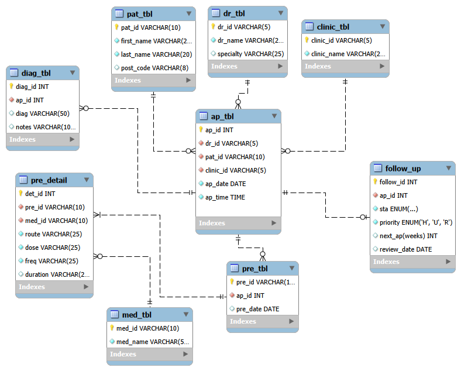

# Crownfield Eye Hospital Database

## Project Overview

This project was developed for the CPU4:103 Introduction to
Database assessment.

I designed and implemented a relational database for a
fictional ophthalmology hospital using MySQL Workbench.
The database was designed to reduce repeated information,
maintain data integrity and make patient and appointment
information easier to manage.

## Database Structure

The database is named crownfield_eye_hospital and contains
nine related tables:

- pat_tbl - Patient information
- dr_tbl - Doctor and staff information
- clinic_tbl - Clinic information
- ap_tbl - Appointment records
- diag_tbl - Diagnosis information
- pre_tbl - Prescription records
- med_tbl - Medicine information
- pre_detail - Prescription details
- follow_up - Follow-up appointments

The database uses primary keys, foreign keys, UNIQUE,
NOT NULL and CHECK constraints.

## Repository Structure

| File | Description |
| --- | --- |
| 01_schema.sql | Database structure, sample data and views |
| 02_individual_queries.sql | Individual SQL assessment queries |
| 03_procedure_and_trigger.sql | Stored procedure and four triggers |
| 04_security.sql | User roles, privileges, hashing and transactions |
| 05_ERD | Entity Relationship Diagram |
| README.md | Project documentation and setup instructions |

## Setup Steps

1. Install MySQL Server 8.0.18 or later and MySQL Workbench.
2. Connect to a MySQL server using an authorised account.
3. Download the SQL files from this repository.
4. Open each SQL file in MySQL Workbench.
5. Execute the files in the order shown below.

## File Execution Order

1. 01_schema.sql
2. 02_individual_queries.sql
3. 03_procedure_and_trigger.sql
4. 04_security.sql

The schema script should be executed on a fresh database.
Sample data must be inserted before the triggers are created
because some historical appointments contain past dates.

The security script requires administrative permissions.
MySQL generates passwords for the demonstration accounts.

The commented trigger test can be executed separately
to demonstrate the expected error message.

## SQL Features

The individual queries demonstrate:

- SELECT
- INNER JOIN and LEFT JOIN
- GROUP BY and HAVING
- Aggregate functions
- Subqueries
- Common Table Expressions (CTE)
- UNION ALL

The database also includes two views, a stored procedure
and four triggers.

## Stored Procedure and Triggers

- GetPatientAppointments - Retrieves appointments for
  a selected patient.
- check_appointment_date - Prevents past appointment dates
  when inserting new appointments.
- CheckDoctorAvailability - Prevents exact-time doctor
  double bookings when inserting appointments.
- CalculateNextAp - Calculates the follow-up review date.
- UpdateNextAp - Recalculates the follow-up review date.

## Database Security

Four user roles are demonstrated:

- Administrator
- Doctor
- Patient
- Receptionist

The security script also demonstrates SHA-256 hashing
using SHA2(), and transactions using ROLLBACK and COMMIT.

No real passwords or server connection credentials are
included in this repository.

## Entity Relationship Diagram

The ERD shows the nine related tables, primary keys,
foreign keys, cardinality and optionality using
Crow's Foot notation.

## Assumptions

- Each patient has a unique patient ID.
- Each appointment belongs to one patient, one doctor
  and one clinic.
- A patient can have multiple appointments.
- An appointment may have diagnoses and prescriptions.
- An appointment may have one optional follow-up record.
- A prescription can contain multiple medicines.
- The database uses sample data for educational purposes.

## Limitations

Patient and staff names and postcodes were replaced for
public submission. Query results may therefore differ
from earlier assessment screenshots.

The stored procedure and security account setup were
reconstructed from the assessment evidence because their
original definitions were not included in the database dump.

The reorganised repository scripts have not been tested
together on a fresh MySQL installation.

The hashing and user permissions are educational
demonstrations rather than complete security measures
for a real hospital system.

Future improvements could include more detailed access
controls, stronger data protection and performance testing
with larger datasets.

## Tools Used

- MySQL Workbench
- MySQL Server
- Aiven
- GitHub

## Module

CPU4:103 Introduction to Database
